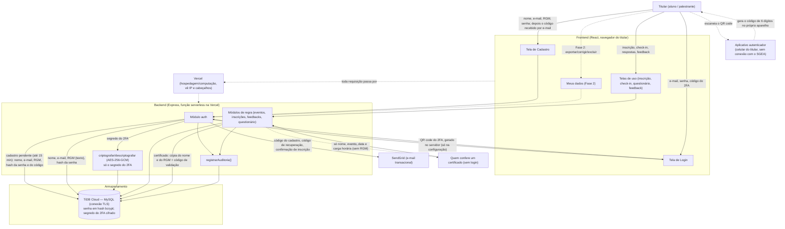

# Inventário de dados pessoais e fluxo de dados — SGEA

**Data:** 06/11/2026 · **Versão:** 4 (confirmação do e-mail no cadastro:
tabela `cadastros_pendentes`, seção 11; tabela `certificados`, seção 12;
e-mail do aluno não editável; IP também no limite de envio do código do
cadastro. A versão 3, de 29/09/2026,
tirou a criptografia de nome, e-mail e RGM e incluiu o 2FA opcional para
todos, a situação da conta e as regras de feedback; a versão 2, de
28/09/2026, incluiu o 2FA, o IP no limite de tentativas e a remoção do
telefone do palestrante)

Responde, para cada dado pessoal tratado pelo SGEA, às perguntas da seção 1
do guia. A finalidade específica e a hipótese legal de cada um estão
detalhadas em `02-matriz-dados-finalidade-base-legal.md`; aqui o foco é
**onde** cada dado entra e circula no sistema.

## 1. Nome, e-mail institucional, RGM (aluno)

- **De quem é:** do aluno que se cadastra.
- **Onde é coletado:** tela pública de Cadastro (`frontend/src/pages/Cadastro/CadastroPage.tsx`),
  enviado a `POST /api/auth/registro`. Os dados ficam primeiro em
  `cadastros_pendentes` (seção 11) e só passam para a conta quando o aluno
  confirma o código enviado ao e-mail (`POST /api/auth/registro/confirmar`).
- **Obrigatório ou opcional:** obrigatório — não é possível criar conta sem os três.
- **Onde fica armazenado:** cada dado numa tabela só, sem cópia — nome e
  e-mail em `usuarios` (`nome`, `emailLogin`, que é também o e-mail de
  login, único e sempre em minúsculo) e RGM em `participantes` (`rgm`,
  único). Em texto puro (dados pessoais comuns, art. 5º, I da LGPD),
  protegidos por controle de acesso por perfil, HTTPS, conexão com o banco
  por TLS, banco com acesso restrito e auditoria (ver
  `07-medidas-tecnicas-de-seguranca.md`). Até 29/09/2026 esses campos eram
  cifrados e repetidos nas duas tabelas, com índices de busca HMAC
  (`emailLoginHash`, `emailHash`, `rgmHash`); a migration
  `20261103150000_dados_pessoais_sem_duplicacao` tirou as cópias e os
  índices, depois da conversão única dos registros antigos para texto.
- **Por quanto tempo:** ver `04-plano-de-retencao-e-descarte.md`.
- **Quem consulta/altera:** o próprio titular (visão própria, hoje limitada
  a `GET /usuarios/me` e à página "Meus dados", só leitura);
  ADMINISTRADOR/SECRETARIA podem consultar e corrigir nome e RGM via tela
  de Participantes. O e-mail não pode ser alterado por ninguém
  (`PUT /api/participantes/{id}` responde 422 se o campo vier): é o login,
  confirmado por código no cadastro. Mudança de e-mail institucional vai
  pelo canal de privacidade (ver `08`).
- **Compartilhado com terceiro:** SendGrid recebe o e-mail e o nome como
  destinatário de mensagens transacionais. Nenhum dos três é enviado a
  nenhum outro serviço.
- **Direitos do titular:** ver `08-procedimento-direitos-dos-titulares.md`.
- **Resposta a incidente:** ver `05-plano-de-resposta-a-incidentes.md`.

## 2. Senha

- **De quem é:** de qualquer conta (aluno, secretaria, administrador).
- **Onde é coletado:** telas de Cadastro e "Esqueci minha senha". Toda
  senha nova precisa ter de 8 a 64 caracteres, com maiúscula, número e
  caractere especial (mesma regra no frontend e no backend,
  `utils/validacao.ts`); o login não confere a regra.
- **Obrigatório:** sim.
- **Onde fica:** `usuarios.senhaHash` (bcrypt, custo 12, salt aleatório por
  senha embutido no hash; hash antigo de custo 10 é refeito no próximo
  login) — nunca em texto puro, nunca logado (`backend/src/utils/password.ts`).
- **Por quanto tempo:** enquanto a conta existir.
- **Quem consulta:** ninguém — nem a equipe, nem quem acessa o banco
  diretamente, consegue recuperar a senha original a partir do hash.
- **Compartilhado:** não.

## 3. Aceite de Termos de Uso e ciência da Política de Privacidade

- **De quem é:** de quem se cadastra.
- **Onde é coletado:** checkbox na tela de Cadastro, gravado no servidor
  (nunca confia em timestamp vindo do cliente) — `auth.service.ts`. O
  instante do aceite e a versão ficam no cadastro pendente
  (`aceiteEm`, `versaoTermos`) e passam para a conta na confirmação do e-mail.
- **Obrigatório:** sim, pra criar conta (`z.literal(true)` no schema de
  registro).
- **Onde fica:** `usuarios.consentimentoLgpdEm` (data/hora) e
  `usuarios.versaoTermosAceitos` (qual versão do Termos/Política foi aceita).
- **Quem consulta:** equipe, via trilha de auditoria (`CONSENTIMENTO_LGPD_ACEITO`).
- **Compartilhado:** não.

## 4. Inscrição, presença (check-in), respostas do questionário

- **De quem é:** do aluno inscrito.
- **Onde é coletado:** autoinscrição do próprio aluno
  (`POST /eventos/:id/inscricoes`) ou inscrição manual pela secretaria;
  check-in feito pela equipe na tela correspondente; respostas enviadas
  pelo próprio aluno na tela de Questionário.
- **Obrigatório:** obrigatório pra quem quer participar do evento e emitir
  certificado.
- **Onde fica:** tabelas `inscricoes` e `tentativas_questionario`.
- **Quem consulta:** o próprio aluno (só as próprias); equipe (todas, sem
  virar ranking exposto a outro aluno — `questionario.routes.ts`). O
  questionário só é respondido por quem teve a presença confirmada.
- **Situação da conta:** a equipe pode inativar o aluno (com motivo, que
  fica só em `participantes.motivoInativacao`); a inativação cancela as
  inscrições pendentes em eventos futuros e mantém presenças e certificados.
- **Compartilhado:** não.

## 5. Feedback da palestra

- **De quem é:** do aluno que avalia.
- **Onde é coletado:** tela de Feedback, só liberada para eventos em que o
  aluno já tem certificado (presença + nota mínima). Só o próprio aluno
  envia; a equipe não escreve feedback em nome de ninguém.
- **Obrigatório:** opcional.
- **Onde fica:** tabela `feedbacks` (nota + comentário em texto livre, até
  1000 caracteres).
- **Quem consulta/altera:** o próprio autor; equipe (todos, com média por
  evento). Ninguém edita depois de enviado: o aluno pode excluir o próprio
  e enviar outro; a equipe só exclui, com motivo.
- **Compartilhado:** não.

## 6. Logs de login, falha, acesso negado e mudança em registro crítico

- **De quem é:** de qualquer pessoa que interage com o sistema autenticada
  ou tenta se autenticar.
- **Onde é gerado:** automaticamente pelo backend em cada operação
  sensível (`backend/src/utils/auditoria.ts` lista todos os códigos de
  ação); nunca é um dado que o titular digita.
- **Obrigatório:** não se aplica (não é opção do titular).
- **Onde fica:** tabela `logs_auditoria`, com uma cópia do nome de quem
  agiu (`atorNome`, em texto) — o campo `detalhe` nunca contém senha,
  token, código ou valor de dado pessoal, só id do registro afetado e um
  motivo curto (no caso da exclusão de feedback pela equipe, um motivo de
  lista fechada).
- **Quem consulta:** ADMINISTRADOR/SECRETARIA, tela de Auditoria.
- **Compartilhado:** não.

## 7. Código de recuperação de senha

- **De quem é:** de quem pede "esqueci minha senha".
- **Onde é coletado/gerado:** gerado pelo servidor, nunca digitado pelo
  titular (ele só digita o código que recebeu por e-mail).
- **Onde fica:** `recuperacoes_senha.codigoHash` (hash bcrypt, nunca texto
  puro), com validade de 15 minutos e limite de 5 tentativas de confirmação.
- **Compartilhado:** enviado por e-mail via SendGrid (o código em texto
  puro vai só no corpo do e-mail para o próprio titular, nunca fica em log
  do servidor — ver correção do achado (g) na Fase 2).

## 8. Nome e e-mail do palestrante

- **De quem é:** de pessoas convidadas a ministrar palestra — não são
  alunos, mas também são titulares de dados pessoais.
- **Onde é coletado:** tela de Palestrantes, preenchida pela secretaria
  (o próprio palestrante não se cadastra).
- **Onde fica:** tabela `palestrantes`, em texto puro por decisão
  justificada em `07-medidas-tecnicas-de-seguranca.md`. O telefone foi
  **removido do sistema** (minimização: não era usado em nenhum fluxo).
- **Quem consulta:** equipe (nome e e-mail); ALUNO (só o nome — o e-mail
  não vem na resposta da API para esse perfil).
- **Compartilhado:** não.

## 9. Endereço IP e metadados de requisição

- **De quem é:** de qualquer visitante do sistema, mesmo antes de logar.
- **Onde é tratado:** (1) pela infraestrutura da Vercel, que executa a
  função serverless, em qualquer requisição HTTP; (2) pelo próprio SGEA,
  só nas rotas de login, de pedido de código de recuperação de senha, de
  envio do código do cadastro e da validação pública de certificado, como
  chave do limite de tentativas por IP (`backend/src/utils/limiteAcesso.ts`).
- **Onde fica:** (1) logs de execução da Vercel, fora do controle direto
  do código do SGEA; (2) tabela `limites_acesso`, coluna `chave`
  (`login:ip:<ip>`, `recuperacao:ip:<ip>`, `cadastro:ip:<ip>` ou
  `validacao:ip:<ip>`), com o número de tentativas e o fim do bloqueio —
  nada além disso é associado ao IP.
- **Por quanto tempo:** (2) o registro permanece depois que o bloqueio
  expira (com o contador zerado); o descarte automático depende da rotina
  de retenção, ainda não implementada.
- **Compartilhado:** com a Vercel (operador de hospedagem/computação).

## 10. Segredo e códigos de recuperação da autenticação em dois fatores

- **De quem é:** de quem decidir ativar, em qualquer perfil (ADMINISTRADOR,
  SECRETARIA ou ALUNO).
- **Onde é gerado:** pelo servidor, quando o titular inicia a configuração
  na página "Minha conta". O QR code com o segredo é gerado no próprio
  servidor do SGEA e mostrado só na tela de configuração; o titular o
  escaneia com um aplicativo autenticador instalado no próprio celular, que
  passa a gerar os códigos de 6 dígitos sem nenhuma conexão com o SGEA.
- **Obrigatório ou opcional:** opcional para todos os perfis.
- **Onde fica:** segredo em `usuarios.mfaSegredoCifrado` (AES-256-GCM — é
  credencial de acesso, por isso continua cifrado), junto com `mfaAtivo`,
  `mfaAtivadoEm` e `mfaUltimoPasso` (contra reuso do mesmo código); os 8
  códigos de recuperação em `codigos_recuperacao_mfa`, só como hash
  (HMAC-SHA256).
- **Por quanto tempo:** enquanto o 2FA estiver ativo; tudo é apagado
  quando o titular desativa ou o administrador reseta.
- **Quem consulta:** ninguém depois da configuração — a API não devolve
  mais o segredo, e os códigos de recuperação só aparecem na ativação.
- **Compartilhado:** não. Não há SMS, e-mail nem API externa de QR code no
  fluxo.

## 11. Cadastro aguardando confirmação do e-mail (`cadastros_pendentes`)

- **De quem é:** de quem preenche o Cadastro e ainda não confirmou o
  e-mail institucional.
- **Onde é coletado:** `POST /api/auth/registro` (passo 1 do cadastro),
  depois de validar tudo. O código de 6 dígitos é gerado pelo servidor
  (`crypto.randomInt`) e enviado ao e-mail informado.
- **Obrigatório:** sim, para criar conta: sem confirmar o código, nenhuma
  conta é criada.
- **Onde fica:** tabela `cadastros_pendentes`: nome, `emailLogin` (único),
  RGM, `senhaHash` (bcrypt, mesmo custo das senhas), `codigoHash` (bcrypt,
  nunca o código puro), `tentativas`, `envios`, `ultimoEnvioEm`,
  `aceiteEm` e `versaoTermos` (o aceite dos Termos) e `expiraEm`. Tabela
  isolada, sem relação com as outras.
- **Por quanto tempo:** até 15 minutos. A linha sai ao concluir o cadastro
  (os dados passam para `usuarios`/`participantes` e o pendente é apagado
  na mesma transação) ou depois de expirar: o expirado é apagado no próximo
  cadastro, em cada login e quando alguém tenta confirmar ou reenviar o
  código daquele e-mail. Preencher o cadastro de novo com o mesmo e-mail ou
  RGM substitui o pendente anterior.
- **Quem consulta:** ninguém por tela. Só o próprio fluxo do cadastro lê a
  linha, pelo e-mail.
- **Compartilhado:** o código em texto puro vai só no corpo do e-mail ao
  próprio titular, via SendGrid; nunca fica em log, auditoria ou mensagem
  de erro.

## 12. Certificados emitidos (`certificados`)

- **De quem é:** do aluno que recebeu o certificado.
- **Onde é gerado:** na primeira emissão (`POST /api/certificados/emitir/{inscricaoId}`,
  pelo próprio aluno ou pela equipe), depois da presença confirmada e de
  60% no questionário. As emissões seguintes devolvem o mesmo registro,
  nunca regerado (`certificados.service.ts`).
- **Obrigatório:** não é dado que o titular digita; existe para quem emite
  o certificado.
- **Onde fica:** tabela `certificados`, uma linha por inscrição, com uma
  **cópia do nome e do RGM** do aluno (`nomeParticipante`, `rgm`) e dos
  dados do evento impressos no PDF (`tituloEvento`, `temaEvento`,
  `nomePalestrante`, `dataEvento`, `cargaHoraria`), o `codigoValidacao`
  (aleatório, `crypto.randomBytes`, sem relação com nenhum id) e
  `emitidoEm`. É a única cópia de nome e RGM fora de `usuarios` e
  `participantes`, de propósito: o documento emitido não muda se o evento
  for editado ou o nome corrigido depois, e a validação confere exatamente
  o que foi impresso.
- **Finalidade:** permitir a **validação pública do código** (RF027):
  quem recebe o certificado confere, sem login, em
  `GET /api/certificados/validar/{codigo}` ou na página
  `/validar-certificado`.
- **Por quanto tempo:** enquanto o certificado precisar ser verificável.
  Por isso o aluno com certificado não é removido, só inativado: a remoção
  responde `409 PARTICIPANTE_COM_CERTIFICADO`, e a inscrição de origem é
  protegida no banco (`onDelete: Restrict`). Ver `04`.
- **Quem consulta:** o próprio aluno (os certificados dele, na tela
  Certificados e em "Meus dados"); ADMINISTRADOR/SECRETARIA (todos);
  qualquer pessoa com o código vê só nome, evento, data, carga horária e
  emissão — **nunca o RGM** (limite de 30 consultas por IP).
- **Compartilhado:** não. O PDF é montado no navegador de quem baixa
  (jsPDF), com os dados que a API devolve.

## Diagrama do fluxo de dados

Nenhum dado pessoal sai do trajeto acima: não há chamada a serviço de IA,
analytics ou CDN de terceiro a partir do frontend (confirmado em
`frontend/index.html` e `frontend/package.json` — só React, React Router e
jsPDF, este último rodando inteiramente no navegador do próprio titular
para gerar o PDF do certificado, sem enviar nada a lugar nenhum). No
backend, as bibliotecas do 2FA (`otplib` para o TOTP e `qrcode` para a
imagem do QR code) rodam dentro da própria função serverless, sem chamar
serviço externo.
