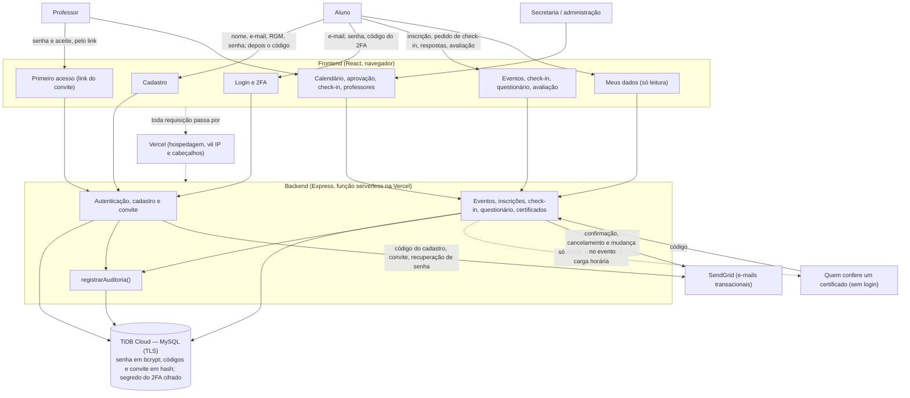

# Inventário de dados pessoais e fluxo de dados — SGEA

**Data:** 12/11/2026 · **Versão:** 1 (acompanha a versão 1 dos Termos de Uso e da
Política de Privacidade)

Responde, para cada dado pessoal tratado pelo SGEA, às perguntas da seção 1
do guia. A finalidade específica e a hipótese legal de cada um estão em
`02-matriz-dados-finalidade-base-legal.md`; aqui o foco é **onde** cada dado
entra e circula no sistema.

## 1. Nome, e-mail institucional e RGM (aluno)

- **De quem é:** do aluno que se cadastra.
- **Onde é coletado:** tela pública de Cadastro
  (`frontend/src/pages/Cadastro/CadastroPage.tsx`), enviado a
  `POST /api/auth/registro`. Os dados ficam primeiro em
  `cadastros_pendentes` (seção 11) e só passam para a conta quando o aluno
  confirma o código enviado ao e-mail (`POST /api/auth/registro/confirmar`).
- **Obrigatório ou opcional:** obrigatório — não é possível criar conta sem
  os três.
- **Onde fica armazenado:** cada dado numa tabela só, sem cópia — nome e
  e-mail em `usuarios` (`nome`, `emailLogin`, que é também o login, único e
  sempre em minúsculo) e RGM em `participantes` (`rgm`, único). Em texto
  puro (dados pessoais comuns), protegidos por controle de acesso por
  perfil, HTTPS, conexão com o banco por TLS, banco com acesso restrito e
  auditoria (ver `07-medidas-tecnicas-de-seguranca.md`).
- **Por quanto tempo:** ver `04-plano-de-retencao-e-descarte.md`.
- **Quem consulta/altera:** o próprio titular (página "Meus dados", só
  leitura); ADMINISTRADOR/SECRETARIA consultam e corrigem nome e RGM na tela
  Participantes; o professor vê nome e RGM só dos inscritos nos eventos
  dele. O e-mail não pode ser alterado por ninguém
  (`PUT /api/participantes/{id}` responde 422 se o campo vier): é o login,
  confirmado por código no cadastro. Mudança de e-mail institucional vai
  pelo canal de privacidade (ver `08`).
- **Compartilhado com terceiro:** SendGrid recebe o e-mail e o nome como
  destinatário de mensagens transacionais (seção 16). Nenhum dos três é
  enviado a outro serviço.

## 2. Senha

- **De quem é:** de qualquer conta (aluno, professor, secretaria,
  administrador).
- **Onde é coletado:** telas de Cadastro, "Esqueci minha senha" e Primeiro
  acesso do professor (pelo link do convite). Toda senha nova precisa ter
  de 8 a 64 caracteres, com maiúscula, número e caractere especial (mesma
  regra no frontend e no backend, `utils/validacao.ts`).
- **Obrigatório:** sim.
- **Onde fica:** `usuarios.senhaHash` (bcrypt, custo 12, salt aleatório por
  senha embutido no hash; hash de custo menor é refeito no próximo login) —
  nunca em texto puro, nunca em log (`backend/src/utils/password.ts`). Conta
  de professor que ainda não usou o convite fica com uma senha inutilizável
  (nenhuma senha digitada confere).
- **Por quanto tempo:** enquanto a conta existir.
- **Quem consulta:** ninguém — nem a equipe, nem quem acessa o banco,
  recupera a senha a partir do hash.
- **Compartilhado:** não.

## 3. Aceite dos Termos de Uso e ciência da Política de Privacidade

- **De quem é:** de quem cria a conta (aluno no cadastro, professor no
  convite).
- **Onde é coletado:** caixa de aceite no Cadastro e na tela de Primeiro
  acesso, gravado pelo servidor (nunca confia em horário vindo do cliente).
  No aluno, o instante e a versão ficam no cadastro pendente (`aceiteEm`,
  `versaoTermos`) e passam para a conta na confirmação do e-mail.
- **Obrigatório:** sim (`z.literal(true)` nos schemas do cadastro e do
  primeiro acesso).
- **Onde fica:** `usuarios.consentimentoLgpdEm` (data/hora) e
  `usuarios.versaoTermosAceitos` (versão aceita; a vigente é a 1, de
  12/11/2026, em `backend/src/config/termos.ts`).
- **Quem consulta:** o próprio titular ("Meus dados") e a equipe, pela
  trilha de auditoria (`CONSENTIMENTO_LGPD_ACEITO`).
- **Compartilhado:** não.

## 4. Inscrição, check-in e respostas do questionário

- **De quem é:** do aluno inscrito.
- **Onde é coletado:**
  - inscrição: autoinscrição do aluno (`POST /api/eventos/{id}/inscricoes`)
    ou inscrição manual pela equipe ou pelo professor do evento;
  - check-in: pedido pelo próprio aluno na tela Eventos
    (`POST /api/eventos/{id}/checkin`, grava a situação e
    `inscricoes.checkinSolicitadoEm`), de 1 hora antes do início até 24
    horas depois do fim, e aprovado ou recusado pelo professor do evento ou
    pela equipe (`/api/checkin`, grava quem decidiu e quando, em `usuarioId`
    e `dataCheckin`). Quando o prazo fecha, o pedido sem decisão vira
    RECUSADO e quem não pediu fica AUSENTE (`utils/checkin.ts`); a auditoria
    registra só as quantidades;
  - respostas: enviadas pelo próprio aluno na tela do Questionário, só com o
    check-in aprovado.
- **Obrigatório:** para quem quer participar do evento e emitir certificado.
- **Onde fica:** tabelas `inscricoes` e `tentativas_questionario`.
- **Quem consulta:** o próprio aluno (só as próprias); a equipe (todas); o
  professor (só as dos eventos dele). Nenhuma tela expõe ranking ou nota de
  um aluno para outro.
- **Situação da conta:** a equipe pode inativar o aluno (com motivo, só em
  `participantes.motivoInativacao`); a inativação cancela as inscrições sem
  pedido de check-in em eventos que ainda não começaram e mantém presenças e
  certificados.
- **Compartilhado:** não (os avisos por e-mail estão na seção 16).

## 5. Avaliação da palestra (feedback)

- **De quem é:** do aluno que avalia.
- **Onde é coletado:** tela de Feedback, liberada só para eventos em que a
  presença do aluno foi confirmada (check-in aprovado, `PRESENTE`), mesmo
  sem ter respondido o questionário. Só o próprio aluno envia. Se a presença
  for desfeita (só antes do questionário), a avaliação é apagada na mesma
  transação, com registro `FEEDBACK_EXCLUIDO` só com ids.
- **Obrigatório:** opcional.
- **Onde fica:** tabela `feedbacks` (nota e comentário em texto livre, até
  1000 caracteres).
- **Quem consulta/altera:** o próprio autor; a equipe (todas, com média por
  evento); o professor (só as dos eventos dele, sem excluir). Ninguém edita
  depois de enviada: o aluno pode excluir a própria e enviar outra; a equipe
  só exclui, com motivo de uma lista fechada.
- **Compartilhado:** não.

## 6. Registros de auditoria

- **De quem é:** de qualquer pessoa que interage com o sistema autenticada
  ou tenta se autenticar.
- **Onde é gerado:** automaticamente pelo backend em cada operação sensível
  (`backend/src/utils/auditoria.ts` lista todos os códigos de ação); nunca é
  um dado que o titular digita.
- **Onde fica:** tabela `logs_auditoria`, com uma cópia do nome de quem agiu
  (`atorNome`). O campo `detalhe` nunca contém senha, token, código, e-mail,
  RGM nem texto livre (motivo de recusa, resposta, comentário, motivo de
  inativação): só ids, quantidades e, na exclusão de avaliação pela equipe,
  um motivo de lista fechada.
- **Quem consulta:** ADMINISTRADOR/SECRETARIA, tela Auditoria.
- **Compartilhado:** não.

## 7. Código de recuperação de senha

- **De quem é:** de quem usa "Esqueci minha senha" numa conta ativa. Conta
  de professor que ainda espera o convite é tratada como e-mail sem conta:
  nada é gerado nem enviado, e a resposta é a mesma.
- **Onde é gerado:** pelo servidor (`crypto.randomInt`); o titular só digita
  o código que recebeu por e-mail.
- **Onde fica:** `recuperacoes_senha.codigoHash` (bcrypt), com validade de
  15 minutos e limite de 5 tentativas de confirmação.
- **Compartilhado:** o código vai só no corpo do e-mail ao próprio titular,
  via SendGrid; nunca fica em log do servidor nem na auditoria.

## 8. Nome e e-mail do palestrante

- **De quem é:** das pessoas convidadas a ministrar palestra.
- **Onde é coletado:** tela Palestrantes, preenchida pela equipe ou pelo
  professor (o palestrante não se cadastra). O que o professor cadastra
  passa pela aprovação da equipe; a mudança de nome ou e-mail de um
  palestrante já aprovado vira proposta de alteração (seção 15).
- **Onde fica:** tabela `palestrantes`, em texto puro (dados pessoais
  comuns; ver `07`). Não há telefone nem outro dado.
- **Quem consulta:** a equipe e o professor que o cadastrou (nome e
  e-mail); os demais perfis veem só o nome, e só de palestrante aprovado.
- **Compartilhado:** não. O sistema não envia e-mail para palestrante.

## 9. Endereço IP e metadados de requisição

- **De quem é:** de qualquer visitante do sistema, mesmo antes de entrar.
- **Onde é tratado:** (1) pela infraestrutura da Vercel, que executa a
  função serverless, em toda requisição HTTP; (2) pelo próprio SGEA, só
  como chave do limite de tentativas por IP (`utils/limiteAcesso.ts`) no
  login, no pedido de código de recuperação de senha, no envio do código do
  cadastro, no link de convite do professor e na validação pública de
  certificado.
- **Onde fica:** (1) logs de execução da Vercel, fora do controle do código;
  (2) tabela `limites_acesso`, coluna `chave` (`login:ip:<ip>`,
  `recuperacao:ip:<ip>`, `cadastro:ip:<ip>`, `primeiro-acesso:ip:<ip>` ou
  `validacao:ip:<ip>`), com o número de tentativas e o fim do bloqueio —
  nada além disso é associado ao IP.
- **Por quanto tempo:** (2) o registro permanece depois que o bloqueio
  expira (com o contador zerado); o descarte automático depende da rotina
  de retenção, ainda não implementada (ver `04`).
- **Compartilhado:** com a Vercel (operador de hospedagem).

## 10. Segredo e códigos de recuperação da autenticação em dois fatores

- **De quem é:** de quem decidir ativar, em qualquer perfil.
- **Onde é gerado:** pelo servidor, quando o titular inicia a configuração na
  página "Minha conta". O QR code é gerado no próprio servidor e mostrado só
  na configuração; o aplicativo autenticador do celular passa a gerar os
  códigos sem nenhuma conexão com o SGEA.
- **Obrigatório ou opcional:** opcional para todos os perfis.
- **Onde fica:** segredo em `usuarios.mfaSegredoCifrado` (AES-256-GCM),
  junto com `mfaAtivo`, `mfaAtivadoEm` e `mfaUltimoPasso` (contra reuso do
  mesmo código); os 8 códigos de recuperação em `codigos_recuperacao_mfa`,
  só como hash (HMAC-SHA256).
- **Por quanto tempo:** enquanto o 2FA estiver ativo; tudo é apagado quando o
  titular desativa ou o administrador reseta.
- **Quem consulta:** ninguém depois da configuração.
- **Compartilhado:** não (sem SMS, e-mail ou API externa de QR code).

## 11. Cadastro aguardando confirmação do e-mail (`cadastros_pendentes`)

- **De quem é:** de quem preenche o Cadastro e ainda não confirmou o e-mail.
- **Onde é coletado:** `POST /api/auth/registro`, depois de validar tudo. O
  código de 6 dígitos é gerado pelo servidor (`crypto.randomInt`) e enviado
  ao e-mail informado.
- **Obrigatório:** sim, para criar conta.
- **Onde fica:** tabela `cadastros_pendentes`: nome, `emailLogin` (único),
  RGM, `senhaHash` (bcrypt), `codigoHash` (bcrypt), `tentativas`, `envios`,
  `ultimoEnvioEm`, `aceiteEm`, `versaoTermos` e `expiraEm`. Tabela isolada.
- **Por quanto tempo:** até 15 minutos. Sai ao concluir o cadastro (os dados
  passam para `usuarios`/`participantes` na mesma transação) ou depois de
  expirar: o expirado é apagado em cada login e em cada cadastro novo.
  Refazer o cadastro com o mesmo e-mail ou RGM substitui o pendente
  anterior.
- **Quem consulta:** ninguém por tela.
- **Compartilhado:** o código vai só no corpo do e-mail ao próprio titular,
  via SendGrid; nunca fica em log, auditoria ou mensagem de erro.

## 12. Certificados emitidos (`certificados`)

- **De quem é:** do aluno que recebeu o certificado.
- **Onde é gerado:** na primeira emissão
  (`POST /api/certificados/emitir/{inscricaoId}`, pelo próprio aluno, pela
  equipe ou pelo professor do evento), depois do check-in aprovado e de 60%
  no questionário. As emissões seguintes devolvem o mesmo registro, nunca
  regerado.
- **Onde fica:** tabela `certificados`, uma linha por inscrição, com uma
  **cópia do nome e do RGM** (`nomeParticipante`, `rgm`) e dos dados do
  evento impressos (`tituloEvento`, `temaEvento`, `nomePalestrante`,
  `dataEvento`, `cargaHoraria`), o `codigoValidacao` (12 símbolos sorteados
  com `crypto.randomBytes`, sem relação com nenhum id) e `emitidoEm`. É a
  única cópia de nome e RGM fora de `usuarios` e `participantes`, de
  propósito: o documento emitido não muda se o evento for editado ou o nome
  corrigido depois.
- **Finalidade:** a **validação pública do código**: quem recebe o
  certificado confere, sem login, em `GET /api/certificados/validar/{codigo}`
  ou na página `/validar-certificado`.
- **Por quanto tempo:** enquanto o certificado precisar ser verificável. Por
  isso o aluno com certificado não é removido, só inativado (a remoção
  responde `409 PARTICIPANTE_COM_CERTIFICADO`, e a inscrição de origem é
  protegida no banco com `onDelete: Restrict`).
- **Quem consulta:** o próprio aluno; a equipe; o professor (só dos eventos
  dele); qualquer pessoa com o código vê só nome, evento, data, carga
  horária e emissão — **nunca o RGM** (limite de 30 consultas por IP).
- **Compartilhado:** não. O PDF é montado no navegador (jsPDF) com os dados
  que a API devolve.

## 13. Conta de professor e de secretaria (`usuarios` com perfil PROFESSOR ou SECRETARIA e `primeiros_acessos`)

- **De quem é:** do professor, cuja conta a secretaria ou a administração
  cria na tela Equipe, ou da secretaria, cuja conta só a administração cria
  na mesma tela.
- **Onde é coletado:** `POST /api/equipe` (o mesmo que `/api/professores`):
  só o **nome completo**, o **e-mail institucional** (`@umc.br`) e o perfil
  (Professor ou Secretaria).
- **Onde fica:** `usuarios` (`nome`, `emailLogin`, perfil `PROFESSOR` ou
  `SECRETARIA`), com
  senha inutilizável e sem aceite dos Termos até usar o convite. O convite é
  um link mandado por e-mail (`APP_URL/#/primeiro-acesso?convite=...`) com
  uma chave aleatória de 32 bytes (`crypto.randomBytes`); em
  `primeiros_acessos` fica só o hash SHA-256 dela (coluna `codigoHash`),
  com validade de 24 horas, uso único e contagem de envios. A chave vai
  depois do `#` (não chega ao servidor ao abrir o link) e a tela a tira do
  endereço assim que a lê. Abrir o link não gasta o convite; ao enviar a
  senha e o aceite (`POST /api/auth/primeiro-acesso`), a conta grava a senha
  e o aceite dos Termos e a linha de `primeiros_acessos` é apagada. Um
  convite novo (reenvio) substitui o anterior. A conta que ainda espera o
  convite pode ser excluída na tela Equipe (por exemplo, criada com o e-mail
  errado): o convite sai junto. A conta com histórico no sistema nunca é
  excluída, só fica inativa; os registros de auditoria ficam em qualquer
  caso (`logs_auditoria.usuarioId` vira nulo e o `atorNome` continua).
- **Para que serve:** o professor cria e organiza os próprios eventos e
  palestrantes, decide o check-in dos alunos inscritos neles e acompanha
  notas, certificados e avaliações; a secretaria administra o sistema junto
  com a administração (salas, alunos, aprovações, professores).
- **O que o professor vê dos alunos:** só nos eventos que ele criou: nome,
  RGM, situação do check-in, notas do questionário e avaliações. Ele não
  acessa a tela Participantes nem a lista geral de alunos (a busca para
  inscrição manual devolve no máximo 20 resultados).
- **O que o professor vê dos outros eventos:** no calendário
  (`GET /api/eventos?de=&ate=`), os eventos de outros professores e da
  equipe que ocupam uma sala chegam só como sala, início e fim ("Sala
  ocupada"), sem título, palestrante, inscritos nem id.
- **Compartilhado:** o link do convite vai por e-mail, via SendGrid, só ao
  próprio professor; nunca em log ou auditoria.

## 14. Aprovação de eventos e palestrantes (`historico_aprovacoes`)

- **Onde fica:** `eventos` e `palestrantes` têm `situacao` (PENDENTE,
  APROVADO ou RECUSADO), `motivoRecusa` (o da última recusa) e `criadoPorId`
  (o professor que criou; nulo = equipe). Cada envio, aprovação, recusa (com
  o motivo), reenvio (com a resposta opcional do professor), proposta de
  alteração e transferência fica em `historico_aprovacoes`, com data, o id e
  uma cópia do nome de quem agiu.
- **Quem consulta:** a equipe e o professor dono do item.
- **Auditoria:** registra só que houve o passo (`EVENTO_APROVADO`,
  `EVENTO_RECUSADO` etc.), nunca o motivo nem a resposta.
- **Por quanto tempo:** enquanto o evento/palestrante existir.

## 15. Propostas de alteração, questionário travado e inativação do professor

- **Proposta de alteração (`propostas_alteracao`):** num evento ou
  palestrante já aprovado, a mudança de sala, horário, carga horária ou
  palestrante (evento) ou de nome e e-mail (palestrante) feita pelo
  professor fica guardada até a equipe aprovar ou recusar, e o item continua
  valendo como está até lá. Guarda só os valores propostos, a situação, o
  motivo da recusa e quem enviou. Uma proposta pendente de outro evento
  reserva a sala proposta.
- **Questionário travado:** depois da primeira tentativa de um aluno, ninguém
  muda o questionário daquele evento.
- **Inativação do professor:** `usuarios.ativo` e `usuarios.motivoInativacao`
  (até 500 caracteres, visível só para a equipe, apagado na reativação,
  nunca copiado para a auditoria). O login recusa a conta inativa e as
  sessões abertas caem. Os eventos em aberto do professor (não encerrados ou
  encerrados há menos de 24 horas) passam antes para outro professor ativo
  ou para a equipe, com registro no histórico e na auditoria (só ids). Os
  encerrados há mais tempo continuam ligados a ele.

## 16. E-mails enviados (SendGrid)

O sistema envia só estes e-mails (`backend/src/modules/email/email.service.ts`):

| E-mail | Para quem | Dados pessoais no e-mail |
|---|---|---|
| Código de confirmação do cadastro | Quem preencheu o Cadastro | O e-mail (destinatário) e o código |
| Convite do professor | O professor cadastrado | E-mail, nome e o link com a chave |
| Código de recuperação de senha | Quem pediu "Esqueci minha senha" | E-mail e o código |
| Confirmação de inscrição | O aluno inscrito | E-mail, nome e os dados do evento |
| Inscrição cancelada pela equipe | O aluno | E-mail, nome e os dados do evento |
| Mudança de sala, horário, carga ou palestrante | Os alunos inscritos no evento | E-mail, nome e o que mudou |

As contas da carga de demonstração (`usuarios.ficticio`) nunca recebem
e-mail: o envio é suprimido antes de chegar ao SendGrid. O palestrante não
recebe e-mail.

## Diagrama do fluxo de dados

Nenhum dado pessoal sai do trajeto acima: não há chamada a serviço de IA,
analytics ou CDN de terceiro a partir do frontend (só React, React Router e
jsPDF, este rodando inteiramente no navegador para gerar o PDF do
certificado). No backend, as bibliotecas do 2FA (`otplib` e `qrcode`) rodam
dentro da própria função serverless, sem chamar serviço externo.
